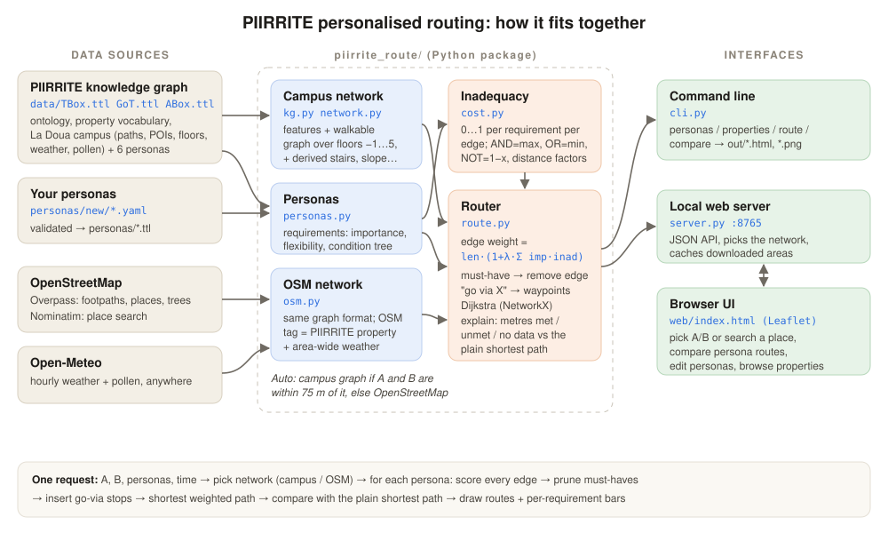

# PIIRRITE personalised routing

Persona-aware pedestrian routing built on the
[PIIRRITE ontology](https://github.com/AIicante2/PIIRRITE-ontology) and its knowledge graph
([Zenodo 21496238](https://zenodo.org/records/21496238), CC BY-NC-SA 4.0). On the LyonTech La Doua
campus it uses the PIIRRITE knowledge graph (indoor floors, campus sensors). Anywhere else it uses
OpenStreetMap paths with live weather and pollen. Each persona (a wheelchair user, someone with
low vision, someone with asthma, a runner...) gets its own route, and the UI shows what that route
gains or loses compared with the plain shortest path.



## How it fits together

| Part | Files | Role |
|---|---|---|
| Data sources | `data/*.ttl`, `personas/`, OpenStreetMap, Open-Meteo | Campus knowledge graph and shipped personas, your personas, paths and places anywhere, hourly weather and pollen |
| Network loaders | `kg.py`, `network.py`, `osm.py` | Turn the campus graph or OSM data into the same format: features with property values, plus a walkable graph |
| Personas | `personas.py` | Read personas from RDF/YAML: requirements with importance, flexibility and a condition tree |
| Scoring | `cost.py` | Inadequacy (0–1) of each requirement on each edge, following the PIIRRITE paper |
| Routing | `route.py` | Weighted edges, must-have pruning, go-via stops, Dijkstra, explanation vs shortest path |
| Interfaces | `cli.py`, `server.py`, `web/index.html` | Command line (HTML/PNG output) and the local browser UI |

The semantic layer (RDF personas + knowledge graph or OSM data) computes a **per-persona weight
for every edge**. NetworkX does the shortest-path search:

```
weight(edge) = length * (1 + λ · Σ importance_i · inadequacy_i(edge, time))
```

Hard requirements (importance `INF`, or importance ≥ 0.9 with flexibility ≤ 0.1) remove
violating edges instead of penalising them. "Go via X" requirements (bins, toilets, benches...)
become waypoints.

## Setup

```bash
python -m venv .venv && .venv/Scripts/pip install -r requirements.txt   # (bin/ on Linux/macOS)
python cli.py personas list        # first run downloads data/*.ttl and builds caches (~20 s)
.venv/Scripts/python server.py      # web UI at http://127.0.0.1:8765
```

## Web UI

```bash
.venv/Scripts/python server.py          # http://127.0.0.1:8765 (--port, --no-browser)
```

- **Route**: place A/B on the map (or drag the markers), pick personas, optionally a weather/pollen
  time and λ / missing-data penalty, then *Find routes*. Each persona's route is drawn as it
  finishes. The cards show length vs the shortest path and, per requirement, how many metres are
  met / unmet / without data compared with the shortest path. Dashed segments are on other floors.
- **Personas**: browse requirements (must-have, go-via, ignored for lack of data); create, edit,
  duplicate, validate and delete added personas in YAML (saved to `personas/<id>.ttl`).
- **Properties**: searchable list of properties with data counts and common values.

### Routing anywhere (OpenStreetMap)

The **Path network** switch picks the graph. *Auto* uses the campus knowledge graph when A and B
are within 75 m of it, and OpenStreetMap otherwise. You can also force *Campus graph* or *OpenStreetMap*.
Use the search box (Nominatim) to jump to a place or set A/B.

`piirrite_route/osm.py` downloads the walkable ways and nearby places around A and B from the
Overpass API (A and B can be up to ~11 km apart). OSM tag keys are the PIIRRITE property names
(`tactile_paving` → `P_TactilePaving`), so the same personas, derived `D_*` properties, scoring
and go-via stops apply unchanged. Weather (`P_Weather_Condition`, `P_Temperature`, ...) comes from Open-Meteo
for the chosen hour (default: now). Pollen intensity is the highest species concentration relative to a
"high" level, capped at 1. It comes from the Open-Meteo CAMS forecast, covers Europe only, and is limited
to the last 90 days and the next 4. Downloads are cached in `data/osm_cache/`.

Limits: in most places OSM has far fewer accessibility tags (wheelchair, smoothness, tactile paving)
than the campus, so expect more "no data" metres. There are no indoor floors or noise/crowd data,
and pollen and weather apply to the whole area rather than varying by place. A and B are sent to
public services (Overpass, Open-Meteo, Nominatim).

The server uses only the standard library (`server.py` + `web/index.html`). Leaflet comes from a CDN.
The base map is drawn from the knowledge graph, and OpenStreetMap tiles are optional.

## Using the existing personas

```bash
python cli.py personas list
python cli.py personas show Anna
python cli.py route   --persona Anna --from 45.7800,4.8650 --to 45.7845,4.8790 --map out/anna.html
python cli.py compare --from 45.7800,4.8650 --to 45.7845,4.8790 --time 2026-06-05T02:30
```

`compare` writes `out/compare.html` (one toggleable layer per persona plus the shortest path;
click a route for its explanation). `--time` selects the weather/pollen values (data covers
2026-04-06 … 2026-06-08).

## Adding a persona

1. Start from a template: `python cli.py personas export Anna -o personas/new/me.yaml`, or copy
   one of `personas/new/*.yaml` (Lea – mobility, Noah – sensory, Ines – physiological,
   Tom – cognitive, Maya – preference).
2. Find properties that actually have data: `python cli.py properties --min 20`
   (`--grep wheel` to filter). `D_*` properties are derived (stairs, indoor, elevator, tram, slope).
3. Validate, then add (writes `personas/<id>.ttl` in the PIIRRITE modelet 4/5 pattern):
   ```bash
   python cli.py personas check personas/new/me.yaml
   python cli.py personas add   personas/new/me.yaml
   ```
   `python cli.py personas remove <id>` deletes an added persona.

YAML format:

```yaml
id: Lea
label: Manual wheelchair user
category: mobility
requirements:
  - label: No stairs
    importance: INF            # 0..1, or INF for must-have
    flexibility: 0.0           # 0..1: tolerance for near-misses
    condition: {property: D_STAIRS, op: EQUALS, value: false}
  - label: Keep away from tram tracks
    importance: 0.7
    flexibility: 0.4
    condition:
      NOT:                     # AND / OR (list) and NOT (one operand), nest freely
        property: D_TRAM
        op: EQUALS             # EQUALS (value or list = any of) | LESSER_THAN | GREATER_THAN
        value: "yes"
        distance: {op: LESSER_THAN, metres: 30}   # distance factor
```

New personas are kept in `personas/`, separate from `data/ABox.ttl`: the upstream
`instanciation.py` regenerates the ABox and would drop anything added there.

## How requirements are scored

| Condition | Inadequacy |
|---|---|
| numeric `<` / `>` | smoothstep over a tolerance band `0.4·f·max(|R|,1)` (noise 50 dB, f=0.25 → 5 dB, as in the paper) |
| numeric `=` | linear over the same band |
| ordinal (`P_Smoothness`, `P_Wheelchair`) `=` | "at least": linear over `3·f` levels |
| categorical / boolean | 0 or 1, scaled by `1 − f/2` at requirement level |
| `AND` / `OR` / `NOT` | max / min / 1 − x (unknown operands skipped) |
| distance factor | distance to the nearest matching entity vs. the threshold, faded over `0.4·f·D` |
| unknown value | `--unknown-penalty` (default 0.25) |

These satisfy the paper's properties: (i) values in [0,1], (ii) 0 when the condition is met,
(iii) increases with the violation, (iv) increases faster when flexibility is lower.

## Data caveats (found while building this)

- Many properties used by the shipped personas have **no data**: `P_Noise`, `P_Crowdy`,
  `P_Sun_Exposition`, `P_Aesthetic_Rating`, `P_Enjoyable`, `P_Charging_Point`, `P_Name`.
  These requirements are reported as *ignored*, not silently scored.
- Inconsistencies are normalised: `pcv:` vs `saref:` property namespaces, `EQUAL`/`EQUALS`/`In`,
  `hasAtomicCondition`, untyped conditions, importance `INF`. The published data uses
  `http://piirrite.univ-lyon1.fr/ontology/core#`, not the w3id IRI from the paper.
- Stairs are derived (handrail / step_count / incline up-down / multi-level stairwell polygons).
  Elevator polygons have no level data, so they do not connect floors.
- Network: 5,339 connected nodes over floors −1…5 after splitting ways at shared vertices,
  linking stairwells across floors and bridging ≤3 m doorway gaps; ~90 small indoor islands remain.
- Weather is a single campus-wide hourly series, so it changes *when* shelter matters but not *where*.

## Tests

```bash
.venv/Scripts/python -m pytest -q
```
